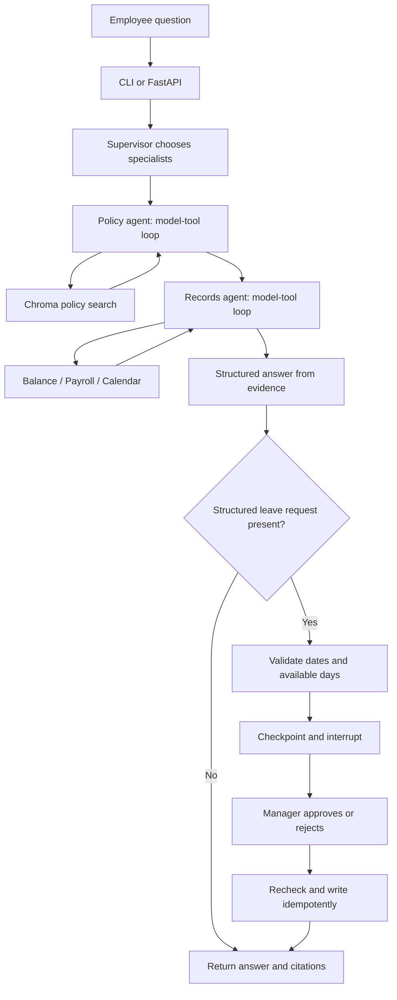

# Build Your First AI Agent — HR Assistant Workshop

Build one interactive Enterprise HR AI Assistant over four hours. An employee checks leave, asks about policy, reads payroll, and requests time off. A manager approves a request before it changes the mock calendar and available balance. The final application exposes the same workflow through FastAPI and includes a Cloud Run deployment pipeline and LangSmith evaluation gate.

This project follows the supplied **Build-Your-First-AI-Agent-Workshop-TOC.xlsx**, including its HR scenario, 240-minute schedule, seeded policy trap, MCP, approval gate, and cloud evaluation capstone. The workbook was treated as curriculum reference, not as authorization to create accounts or deploy services. Multi-agent coordination is added to Hour 3 to address your request.

`Readme.me` contains the same guide, using your requested filename. Each hourly folder also contains both `README.md` and `Readme.me`.

## The real-world use case

Imagine an HR helpdesk receiving this request from Asha, employee `E001`:

> What is my leave balance? Explain the leave policy, show my payroll and calendar, and request leave from 2026-10-05 to 2026-10-07.

Instead of manually consulting several systems, the assistant reads the relevant records and policies, assembles an answer, and presents an explicit approval request. Three weekdays are requested. The starting balance is 12 days; it stays at 12 while approval is pending and becomes 9 only after approval. The approved request appears immediately in the mock calendar.

“Real time” here means interactive requests and immediate updates to the local application. The employee, payroll, and policy data are synthetic, and the calendar is a mock system. This project does not connect to a live employer's HR platform. Replacing the CSV adapters with authenticated HR APIs is the natural next step.

## Hour-by-hour connection

| Hour | Topic from the TOC | Capability added to this use case | Timing | Entry point |
|---|---|---|---|---|
| 1 | Agent anatomy and tool calls | Read Asha's balance and calculate requested working days; compare raw calls with a graph | 12 + 24 + 24 minutes | [Hour 1](hour_01/README.md) |
| 2 | RAG, memory, structured answers | Retrieve HR rules with citations; remember a follow-up; refuse the missing sabbatical policy | 12 + 24 + 24 minutes | [Hour 2](hour_02/README.md) |
| 3 | Orchestration, HITL, MCP, tracing | Coordinate policy and records agents, query four tools, pause before applying leave, trace the request | 12 + 26 + 22 minutes | [Hour 3](hour_03/README.md) |
| 4 | Deploy, verify, observe | Expose the assistant through an API; deploy a candidate; evaluate five cases before promotion | 12 + 26 + 22 minutes | [Hour 4](hour_04/README.md) |

Total: **48 minutes theory + 192 minutes hands-on = 240 minutes**. Account setup and dependency installation happen before the workshop.

## Set up and run

1. Extract the entire project. Keep the four hour folders, `hr_agent`, and `data` together. All commands below run from the `hr-agent-workshop` root, not from inside an hour folder.
2. Install Python **3.14** for the delivered dependency lock. The TOC allows Python 3.11+, but this package is tested on 3.14 and the Docker/CI configuration uses 3.14. Do not mix the lock with an older interpreter during class.
3. Create a virtual environment and install dependencies:

   ```bash
   python3.14 -m venv .venv
   source .venv/bin/activate
   python -m pip install -r requirements.txt
   cp .env.example .env
   ```

   Windows PowerShell equivalents: `py -3.14 -m venv .venv`, `.\.venv\Scripts\Activate.ps1`, and `Copy-Item .env.example .env`. Subsequent `python -m ...` commands are the same.

4. Run without paid API calls first:

   ```bash
   python -m hour_01.app "What is my leave balance for 2026-10-05 to 2026-10-07?"
   python -m hour_02.app "What is the carry forward policy?"
   python -m hour_03.app "Show my leave balance, payroll and calendar"
   python -m pytest tests -q
   ```

5. Launch the final application:

   ```bash
   python -m uvicorn hour_04.api:app --host 127.0.0.1 --port 8080
   ```

6. Open [the interactive API page](http://127.0.0.1:8080/docs). Expand `POST /ask`, click **Try it out**, enter `local-employee-key` in `x-api-key`, and submit:

   ```json
   {"question":"What is the carry forward policy?"}
   ```

   Expected response excerpt:

   ```json
   {
     "status":"answered",
     "answer":"carry forward: Employees may carry forward up to 5 unused annual leave days into the next year.",
     "citations":["LEAVE-02"]
   }
   ```

   Full responses include `thread_id` and tool `evidence`. The generated sample files in each hour show complete responses. Live-model wording can vary.

## Demo mode versus live AI mode

| Capability | `HR_MODE=demo` | `HR_MODE=live` |
|---|---|---|
| Tool choice | Deterministic scripted fixture for the provided exercises | LLM chooses tool calls |
| LangGraph | Real graph execution | Same graph execution |
| Retrieval | Real Chroma store with local hash embeddings | Chroma with OpenAI API embeddings |
| Multi-agent plan | Fixed rules select specialist agents | LLM produces a typed specialist plan |
| Answer | Deterministic formatter | Model produces validated structured output |
| Memory and approval | Real SQLite checkpoints and interrupts | Same |
| External MCP | Real stdio server/client | Same |
| LangSmith | Optional tracing | Tracing plus API-backed evaluation |

Demo mode is a reproducible practice fixture, not an AI quality demonstration. It supports the sample vocabulary; do not judge general language understanding from it. The raw API lab requires live mode.

To enable live mode, edit `.env`:

```dotenv
HR_MODE=live
OPENAI_API_KEY=your-key
OPENAI_MODEL=gpt-4.1-mini-2025-04-14
LANGSMITH_TRACING=true
LANGSMITH_API_KEY=your-langsmith-key
LANGSMITH_PROJECT=hr-agent-workshop
```

Restart the CLI/server, then run `python -m hr_agent.retrieval` to embed the four policies. `OPENAI_MODEL` is a fixed workshop default; verify that your account has access before class. If it does not, choose a model supporting Chat Completions tool calls and structured output, and rerun the tests and live evaluation. Embeddings use `text-embedding-3-small`. API-backed commands incur usage on your accounts.

The raw lab explicitly sends tool definitions, executes requested functions, and sends tool observations back to the model. Its implementation follows the [official function-calling guide](https://developers.openai.com/api/docs/guides/function-calling).

## Project workflow



The diagram illustrates a request needing both specialists; routing skips an unneeded specialist. The supervisor has a bounded plan. The policy agent receives only `policy_search`; the records agent receives balance, payroll, and calendar tools. Each live specialist has its own model/tool loop and observations. This is sequential coordination, which keeps the lab easy to inspect. It is not parallel execution. Neither specialist can apply leave: that operation exists only after the manager interrupt.

`hr_agent/agent.py` owns the inner agent loop; `workflow.py` owns coordination and approval; `service.py` owns checkpoints and thread namespacing; `business.py` owns deterministic rules and mock writes. Hours 1 and 2 reuse the inner loop with progressively more tools. Hour 4 serves the Hour 3 workflow through HTTP.

LangGraph stores progress under an employee-scoped thread ID. Approval resumes the saved graph with `Command(resume=...)`. The write has a unique request ID and checks for a prior write, overlapping dates, and sufficient balance within a SQLite transaction. This prevents a retry from deducting leave twice. See [LangGraph interrupts](https://docs.langchain.com/oss/python/langgraph/interrupts) for the underlying pause/resume behavior.

## CSV data and productive batch use

| File | Meaning | Used in |
|---|---|---|
| `data/employees.csv` | Starting annual leave allocation; one row per employee | Hours 1–4 |
| `data/policies.csv` | Four synthetic policy chunks with stable citation IDs | Hours 2–4 |
| `data/payroll.csv` | One synthetic September 2026 payroll row per employee | Hours 3–4 |
| `data/sample_questions.csv` | Four read-only helpdesk questions | Batch exercise |
| `data/eval_cases.csv` | Five reference cases, including the seeded trap | Hour 4 gate |

Use the batch runner to prepare answers for a small helpdesk queue:

```bash
python -m hr_agent.batch --input data/sample_questions.csv --output .runtime/batch_answers.csv
```

The output contains `case_id,status,answer,citations`. It preserves row order and makes no leave applications. Use synthetic data during training. Changing an employee balance affects subsequent lookups; approved requests are subtracted from that starting allocation. This is one workshop leave bucket, not a full annual accrual system. Payroll is a fixed dataset, not a live payslip feed.

Editing policy text is picked up when indexing in a fresh CLI process. After editing, run `python -m hr_agent.retrieval` and restart a running server. If removing policies or changing IDs, stop the app and remove only its generated Chroma directory before rebuilding, because upserts alone do not delete removed IDs.

## Verify what happened

- For a read: inspect the JSON `evidence` to see tool names and observations.
- For policy: confirm each citation exists in `policies.csv` and supports the answer.
- For memory: repeat an Hour 2 request with the same `--thread`; compare with a fresh thread.
- For approval: confirm the balance is unchanged before resume, then check the calendar after approval.
- For traces: open your LangSmith project, select `hr-request`, and inspect supervisor, specialist, model, and tool spans. The raw CLI prints a tool/action trace, not private model reasoning.
- For cloud: follow [Hour 4 deployment](hour_04/DEPLOYMENT.md), then inspect the smoke-test result, five-case experiment, and pipeline summary URL.

LangSmith tracing is enabled through environment variables and instrumented LangGraph/model calls; the service methods also use `@traceable`. See the [LangSmith Python SDK reference](https://reference.langchain.com/python/langsmith/observability/sdk/).

## Scope and runtime boundaries

The CLI represents a trusted instructor/operator and can select a synthetic employee. The API binds the employee key to `E001` and uses a different manager key for approval. Model tool arguments cannot choose another employee. This is a single-employee workshop API, not enterprise authentication or manager-role management.

Local SQLite files survive process restart when `.runtime` is preserved. Run only one API worker. The provided Cloud Run deployment enables **read-only mode** because instance-local SQLite is ephemeral and unsuitable for durable cloud approvals. All four read tools and multi-agent responses remain available in the cloud; the leave approval lab runs locally or in Docker with a persistent volume. To support cloud approvals, first replace both the checkpointer and business ledger with shared durable storage, then add enterprise identity, manager authorization, and concurrent-request tests.

The cloud pipeline implements an isolated candidate service, smoke tests, a LangSmith experiment, and promotion only after passing. It does not publish anything merely by opening this project. Actual cloud deployment and paid-model/evaluation runs require your configured accounts and credentials. See `VALIDATION.md` for the exact checks performed while building this package.

## Troubleshooting

| Symptom | Fix |
|---|---|
| `No module named hr_agent` | Run from the extracted project root with `python -m hour_01.app`, not `python hour_01/app.py` |
| Model/API authentication error | Check `HR_MODE`, `OPENAI_API_KEY`, and model access; restart after `.env` edits |
| No LangSmith trace | Enable tracing before launch, verify the key/project/region endpoint, then rerun one request |
| API returns 401 | Use the employee key for `/ask` and manager key for `/resume` |
| API returns 503 | Configure the required API key on the server |
| Resume returns 409 | Use the returned thread ID for a pending request; it may already be completed or runtime storage was lost |
| Lower-than-expected balance | Prior approved requests exist in `.runtime/leave.sqlite`; use a fresh runtime for the baseline examples |
| Cloud leave request returns 403 | Expected in the read-only cloud deployment; use the local approval lab |
| Live evaluation fails | Inspect the failing case and trace; check citations, reference agreement, mode, and data state before rerunning |

For a clean practice run, stop all processes and set `HR_RUNTIME` to a new empty folder before launch (for example `export HR_RUNTIME="$PWD/.runtime-practice-2"`). This preserves prior work. To avoid committing alternate runtimes, keep them under `.runtime/`, or add their names to `.gitignore`.
