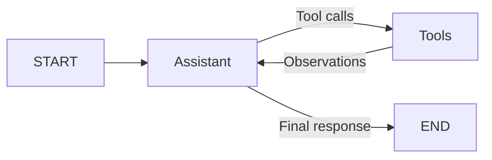

# Hour 1 — Agent anatomy and first tool-calling agent

**Use case:** Asha wants to know whether her 12-day balance can cover three weekdays of leave. The agent must obtain a balance and calculate dates instead of guessing. This hour is read-only; applying leave arrives in Hour 3.

## 60-minute run sheet

| Time | Topic | Hands-on result |
|---|---|---|
| 00–12 | Agent vs chatbot vs fixed workflow; tool schemas; framework choices | Explain where a model chooses the next action |
| 12–36 | Raw function-calling loop | Model → tool call → execution → observation → final answer |
| 36–60 | Rebuild with LangGraph | State, assistant node, tool node, conditional edge, bounded loop |

Theory totals 12 minutes; labs total 48. Complete the root setup before starting the clock.

## Concepts connected to the project

A chatbot can draft an answer but has no built-in access to Asha's current balance. A fixed script could always call both functions. An agent can choose a relevant tool, read its result, and choose another action. This flexibility helps with varying HR questions, but date counting and balance arithmetic still belong in deterministic code.

The raw API path teaches the message protocol; the framework path makes state and transitions visible. LangGraph suits this workshop's later checkpoint and approval needs. CrewAI is another role-oriented approach; provider SDKs can fit smaller provider-specific agents. MCP standardizes access to external tools; A2A concerns communication between agents. Neither is required for the first two local tools. Do not add an agent when one fixed calculation or database query is sufficient.

## Lab A — Run the explicit API loop

1. Activate the root virtual environment and configure live mode and the model API key in `.env`.
2. Open `hour_01/raw_agent.py`. Inspect the two JSON tool definitions: `leave_balance` takes no employee ID; `date_calculator` takes ISO start/end dates.
3. Run:

   ```bash
   python -m hour_01.raw_agent "What is my leave balance, and how many working days are 2026-10-05 to 2026-10-07?"

   1. What is my current leave balance?
   2. How many working days are there from 2026-10-05 to 2026-10-07?
   3. Can my leave balance cover 2026-10-05 through 2026-10-07?
   4. How many working days are there from 2026-10-03 to 2026-10-04?
   5. How many working days are there from 2026-10-02 to 2026-10-05?
   6. How many working days is 2026-10-05?
   7. How many working days are there from 2026-10-10 to 2026-10-05?
   8. What is the carry-forward leave policy?
   ```

4. Read the printed trace. A representative action is:

   ```json
   {"step":1,"tool":"date_calculator","arguments":{"start":"2026-10-05","end":"2026-10-07"},"observation":{"working_days":3}}
   ```

5. Confirm a balance lookup returned 12 and the calculator returned 3. The live model may change call order or use more than one turn. The loop stops after a final answer or fails after eight turns.
6. Explain why each tool result must reference the originating tool-call ID. Inspect the second model request: it includes the observations.

This lab uses [OpenAI function calling](https://developers.openai.com/api/docs/guides/function-calling). Printed traces show requested actions and tool results, not hidden chain-of-thought. No paid API run was required to create the deterministic samples.

## Lab B — Run the same use case in LangGraph

1. Start in `HR_MODE=demo` for a repeatable check.
2. Open `hr_agent/agent.py` and locate `AgentState`, `assistant`, `execute`, and the conditional edge.
3. Run:

   ```bash
   python -m hour_01.app "What is my leave balance for 2026-10-05 to 2026-10-07?"
   ```

4. Expected fields:

   ```json
   {
     "status":"answered",
     "answer":"Available annual leave: 12 days. Requested working days: 3.",
     "citations":[]
   }
   ```

   See `sample_output.json` for the full executed output.

5. Change the dates to Friday `2026-10-02` through Monday `2026-10-05`. Expect 2 working days. A weekend-only range returns 0. A reversed range is invalid.
6. Switch to live mode and repeat. The graph structure is unchanged, but the LLM now chooses the tools.



## Explain the code

`tools_for(employee, 1)` binds a trusted employee identity and returns exactly two tools. `AgentState.messages` uses the `add_messages` reducer so tool observations are appended. The conditional edge checks whether the last assistant message contains tool calls. The tool node validates/executes them and appends `ToolMessage` records. A recursion limit bounds graph execution.

The raw implementation exposes all message assembly; LangGraph supplies the graph execution model. Both rely on the same deterministic functions in `business.py`. Available days come from `employees.csv` minus any earlier approved workshop requests. No public holiday, accrual, or half-day calculation is modeled.

## Finish and carry forward

Check that both tools appear in `evidence` and that the result is 12 available/3 requested on a clean runtime. Explain why an answer with no lookup would be unreliable. Hour 2 adds `policy_search` to this same loop and a checkpointer for conversation history.

Exercise: ask only for the balance and inspect which tools run. In live mode, compare latency and number of calls with the multi-step question. Record actions and observations instead of trying to print private reasoning.
