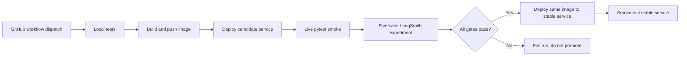

# Hour 4 — Deploy, verify, observe

**Use case:** HR wants the assistant available through an HTTP application, with a check that policy answers stay grounded after a change. The deployment pipeline tests a candidate service, scores five HR questions, and promotes only a passing candidate image.

## 60-minute run sheet

| Time | Topic | Hands-on result |
|---|---|---|
| 00–12 | Agent-as-API, containers, secrets, evaluation gates, runtime options | Explain how users call the workflow and how a release is checked |
| 12–38 | FastAPI, Docker, GitHub Actions, Cloud Run | Build container and run the configured deployment workflow |
| 38–60 | Live smoke tests, LangSmith dataset and experiment | Inspect scores, failing cases, trace, and service URL |

Provision cloud accounts, IAM, secrets, and repository variables **before** this hour. See [DEPLOYMENT.md](DEPLOYMENT.md). An unprovisioned cloud account will not fit the 26-minute lab.

## Lab A — Run the API locally

1. From the project root, activate the environment and copy `.env.example` to `.env` if not already done. Keep demo mode for the first run.
2. Start:

   ```bash
   python -m uvicorn hour_04.api:app --host 127.0.0.1 --port 8080
   ```

3. In another terminal:

   ```bash
   curl -s http://127.0.0.1:8080/health
   curl -s http://127.0.0.1:8080/ask \
     -H 'Content-Type: application/json' -H 'X-API-Key: local-employee-key' \
     -d '{"question":"What is the carry forward policy?"}'
   ```

4. Expected health: `{"status":"ok","mode":"demo"}`. The question returns `answered`, a 5-day carry-forward answer, `LEAVE-02`, and evidence. See `sample_api_output.json` for a complete executed response.
5. Open [Swagger UI](http://127.0.0.1:8080/docs) to run the same request in the browser. This is the application's interactive workshop interface.

### Check the approval API locally

```bash
curl -s http://127.0.0.1:8080/ask \
  -H 'Content-Type: application/json' -H 'X-API-Key: local-employee-key' \
  -d '{"question":"Apply leave","thread_id":"api-approval","leave":{"start":"2026-12-07","end":"2026-12-09"}}'

curl -s http://127.0.0.1:8080/threads/api-approval/resume \
  -H 'Content-Type: application/json' -H 'X-Manager-Key: local-manager-key' \
  -d '{"approved":true}'
```

First expect `pending_approval`, then `applied`. Use a fresh thread/range for another application; overlapping leave is rejected. JSON `true`/`false` are required; strings such as `"false"` are invalid. A wrong key returns 401. A missing server key returns 503. Unknown/already-completed approval returns 409.

The employee cannot self-approve using the employee key. The example manager key represents an instructor, not a complete enterprise identity system.

## Lab B — Containerize

1. Inspect the root Dockerfile. It installs the pinned dependencies, runs as a non-root user, and starts one Uvicorn worker.
2. Build and run:

   ```bash
   docker build -t hr-agent-workshop .
   docker volume create hr-workshop-state
   docker run --rm --name hr-agent -p 8080:8080 --env-file .env \
     -v hr-workshop-state:/app/.runtime hr-agent-workshop
   ```

   Stop the earlier local server first to free port 8080. The volume preserves local checkpoints and the ledger across container restarts.

3. Repeat `/health`, `/ask`, and an approval. Inspect the returned calendar and balance. Do not put keys into the Dockerfile or image.
4. Proceed to the Cloud Run workflow in [DEPLOYMENT.md](DEPLOYMENT.md). The cloud configuration deliberately sets `HR_READ_ONLY=true`; approvals require durable shared cloud storage before enabling them there.

## Lab C — Verify and evaluate the deployed assistant

1. Get the service URL from the pipeline summary or `gcloud run services describe`.
2. Export it and your employee key:

   ```bash
   export HR_BASE_URL=https://YOUR-SERVICE-URL
   export HR_EMPLOYEE_API_KEY=your-configured-employee-key
   python -m pytest hour_04/test_live.py -q
   ```

3. Expected: one passing smoke test. It checks health, makes a policy request to the actual HTTP endpoint, validates the schema, and requires `LEAVE-02`.
4. Configure your LangSmith and model keys in `.env`, then run:

   ```bash
   python -m hour_04.evaluate
   ```

5. This creates a new five-case dataset in your LangSmith account, calls the deployed endpoint for each input, and runs two evaluators:

   | Evaluator | Checks | Required score |
   |---|---|---|
   | Programmatic `structured` | JSON schema, expected status, required citation, exact refusal contract | All 5 cases score 1 |
   | LLM-as-judge `correctness` | Agreement with the reference answer; unsupported facts penalized | Mean at least 0.8 across all 5 |

   Missing scores or run errors also fail the gate. The five cases are balance, carry-forward, remote work, payroll, and missing sabbatical policy. Run against a clean baseline service; the expected balance is 12.

6. Open `eval-results.json`. A **format illustration**, not a claimed experiment result:

   ```json
   {
     "experiment":"hr-cloud-gate-<generated>",
     "dataset_id":"<generated>",
     "scores":{"structured":[1,1,1,1,1],"correctness":[1,1,1,1,1]},
     "run_errors":0,
     "passed":true
   }
   ```

7. In LangSmith, open the named experiment, examine each score, and follow a run into its trace. Keep the experiment URL in your workshop notes. If it fails, inspect the actual answer and citation before editing the prompt or data. Never turn a missing evaluation into an automatic pass.

The implementation uses LangSmith's [evaluation workflow](https://docs.langchain.com/langsmith/evaluate-llm-application). The judge is a model-based measurement, so it is not proof of correctness. The deterministic status/citation checks complement it.

## Deployment workflow



A stable-service smoke failure marks the run red but does not automatically roll back; the deployment guide includes a rollback command. Cloud Run is the primary implementation. Hugging Face Docker Spaces is a manual fallback using the same container; Render and LangGraph-managed deployment are discussion alternatives, not additional implemented pipelines.

## Completion criteria

Your capstone is complete when you have your own service URL, a successful live smoke test, a passing five-case experiment, and a green workflow run. The provided code and instructions prepare that work; `VALIDATION.md` distinguishes local tests performed during package creation from the account-dependent steps you will run.
